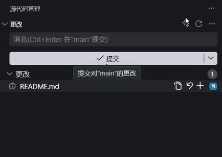
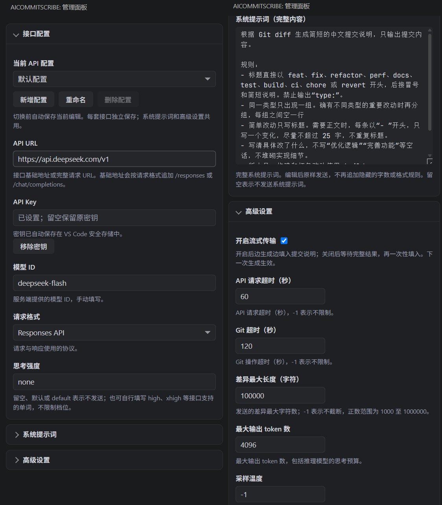

# AICommitScribe

在 VS Code 中，根据 Git 代码改动一键生成提交说明。

默认使用简体中文和 Conventional Commits 格式，支持自定义模型、API 接口与系统提示词。生成结果直接填入源代码管理的提交输入框，检查或修改后即可提交。




## 功能

- **一键生成**：从源代码管理面板读取代码差异，生成并填入提交说明。
- **暂存区优先**：存在已暂存改动时，只分析暂存区；没有暂存改动时，分析工作区改动，包括未跟踪文件。
- **自选模型与接口**：支持 Responses 和 Chat Completions 两种请求格式，可连接兼容接口的云端或本地服务。
- **多套接口配置**：保存不同的接口地址、模型、密钥和思考强度，按需切换。
- **自定义提示词**：调整语言、格式、篇幅与表达习惯，适应个人或团队的提交规范。
- **流式输出**：边生成边显示，也可关闭流式传输，等待完整结果后一次性填入。
- **随时停止**：生成期间可点击停止按钮；如果手动修改了提交说明，后续生成结果会保留你的编辑。

## 安装

需要 VS Code **1.93.0 或更高版本**、可用的 Git，以及一个支持上述请求格式的模型服务。

从 [GitHub Releases](https://github.com/sdn205/ai-commit-scribe/releases/latest) 下载 `ai-commit-scribe-版本号.vsix` 安装包后：

1. 打开 VS Code 的扩展面板。
2. 点击右上角的 **…**，选择 **从 VSIX 安装…**（Install from VSIX）。
3. 选择安装包，按提示完成安装。

也可以通过命令行安装，将文件名替换为实际的安装包路径：

```sh
code --install-extension <扩展安装包.vsix>
```

## 快速开始

### 1. 配置模型服务

打开一个本地 Git 仓库，通过源代码管理面板菜单中的 **打开管理面板** 配置接口。也可以在命令面板中搜索该命令。



| 配置项 | 填写说明 |
| --- | --- |
| API URL | 服务的基础地址或完整请求地址，例如 `https://your-api.example/v1` |
| API Key | 服务提供的密钥；免认证的本地服务可留空 |
| 模型 ID | 服务端支持的准确模型名称 |
| 请求格式 | 根据服务支持情况选择 Responses 或 Chat Completions |
| 思考强度 | 可留空使用默认值，也可填写模型支持的强度值 |

配置修改后会自动保存。API Key 存储在 VS Code 的安全存储中。

基础地址会根据请求格式追加对应路径。例如，填写 `https://your-api.example/v1` 时：

| 请求格式 | 请求地址 |
| --- | --- |
| Responses | `https://your-api.example/v1/responses` |
| Chat Completions | `https://your-api.example/v1/chat/completions` |

如果服务要求 `/v1` 前缀，需要在地址中填写。也可以直接填写完整的请求地址，并选择匹配的请求格式。不同服务对参数的支持可能不同，请以服务端文档为准。

### 2. 生成提交说明

1. 修改代码，将本次准备提交的文件加入暂存区。
2. 打开 **源代码管理** 面板。
3. 点击标题栏中的闪光图标 **生成提交说明**。
4. 检查生成结果，按需编辑，然后使用 VS Code 原有的提交操作完成提交。

扩展只生成提交说明，不会自动执行提交或推送。

默认快捷键为 Windows / Linux 的 `Ctrl+G`、macOS 的 `Cmd+G`，在满足 Git 源代码管理上下文条件时生效。可在 VS Code 键盘快捷方式中搜索 **生成提交说明** 进行修改。

## 按自己的习惯生成

### 调整提交风格

在管理面板的 **系统提示词** 中编辑完整提示词。默认提示词要求使用简体中文，按以下格式生成：

```text
type(可选 scope): summary
```

小改动通常只生成标题，复杂改动可以附带简短正文。例如：

```text
feat(settings): 支持保存和切换多套接口配置

- 为每套接口分别保存模型和密钥
- 切换配置前自动保存当前编辑
```

可以在提示词中指定“使用英文”“只输出一行标题”或团队约定的格式。提示词会按编辑后的内容发送；清空后不发送系统提示词。实际输出取决于所选模型。

### 切换模型服务

在 **当前 API 配置** 中新增、重命名或切换配置。例如，可以分别保存一个云端模型和一个本地模型。

每套配置独立保存连接信息与密钥；系统提示词和高级设置共用。默认配置保留，不能删除。

### 高级设置

| 设置 | 默认值 | 说明 |
| --- | --- | --- |
| 开启流式传输 | 开启 | 关闭后等待完整结果再填入，下一次生成生效 |
| API 请求超时 | 60 秒 | `-1` 表示不限制 |
| Git 超时 | 120 秒 | `-1` 表示不限制 |
| 差异最大长度 | 100000 字符 | 超出时截断 Git diff；`-1` 表示不截断 |
| 最大输出 token 数 | 4096 | 包括推理模型的思考预算 |
| 采样温度 | `-1` | 不发送温度参数，使用服务默认值 |

## 常见问题

### 为什么生成结果没有包含所有修改？

存在已暂存改动时，扩展只分析暂存区。请将本次提交需要包含的改动全部暂存后重新生成。较大的差异还可能受到 **差异最大长度** 限制。

### 可以生成英文提交说明吗？

可以。在系统提示词中指定输出语言即可。

### 可以连接本地模型吗？

可以，只要本地服务提供兼容的 Responses 或 Chat Completions 接口。填写本地服务地址、模型 ID 和对应的请求格式；服务不要求认证时，API Key 可留空。

### 请求失败或没有生成结果怎么办？

先检查 API URL、请求格式、模型 ID 和密钥是否匹配。请求超时可以适当增加超时设置；提示输出被截断时，可以增加最大输出 token 数。也可以打开 VS Code 的 **输出** 面板，查看 `AICommitScribe` 日志。

### 哪些内容会发送给模型服务？

生成时，扩展会向所配置的 API 地址发送 Git diff、可用的 Git blame 分析和系统提示词。代码差异可能包含文件路径和源码；使用云端服务时，这些内容会交由所选服务处理。

## 从源码打包

安装受当前构建依赖支持的 Node.js 和 npm，在仓库根目录运行：

```sh
npm ci
npm run typecheck
npm run package
```

生成的 `.vsix` 安装包位于 `release/` 目录，可按上面的安装步骤加载到 VS Code。

## 问题反馈

欢迎通过本仓库的 Issues 反馈问题或提出建议。反馈时请附上 VS Code 与扩展版本、所用请求格式、复现步骤和相关错误信息；分享日志前请移除密钥及其他敏感内容。
